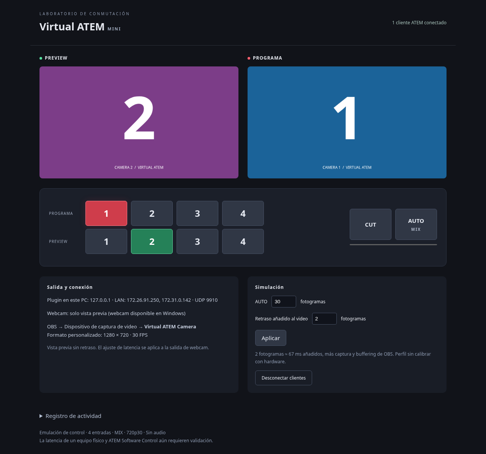
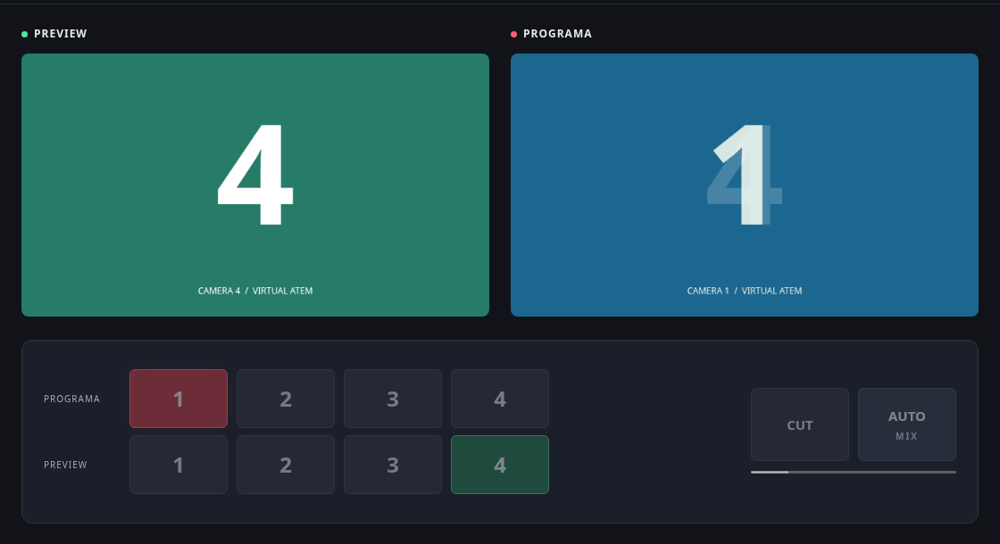

# Virtual ATEM

**Español** · [English](README.en.md)

Emulador de laboratorio para probar [ATEM FT OBS](https://github.com/Lechuga-visual/atem-ft-obs)
sin un mezclador físico. Simula cuatro cámaras, programa, preview, CUT y AUTO/MIX
mediante el protocolo de control ATEM. En Windows entrega la salida de programa
como una webcam virtual seleccionable en OBS.

**[Descargar Windows x64 · v0.1.1](https://github.com/Lechuga-visual/virtual-atem/releases/download/v0.1.1/Virtual-ATEM-0.1.1-windows-x64.zip)**
· [Releases](https://github.com/Lechuga-visual/virtual-atem/releases)
· [Cambios](CHANGELOG.md)
· [Licencias de terceros](THIRD_PARTY.md)

Versión de pruebas: la compatibilidad con el cliente del plugin está comprobada;
la captura completa en OBS real sigue pendiente de confirmar después de la
corrección de arranque de 0.1.1. La latencia aún no está calibrada con hardware.

## Capturas del panel



Panel real: **programa 1** en rojo, **preview 2** en verde y un cliente ATEM de
prueba conectado. Abajo están la conexión, la duración de AUTO y el retraso añadido
al video. Las direcciones LAN dependen del equipo donde ejecutes la app.

Captura tomada en Linux con Chromium y `atem-connection` 3.10.3. Por eso indica
«solo vista previa» para la webcam; no es una captura de OBS ni una validación de
la cámara de Windows. La interfaz actual del panel está en español.

## Qué incluye

| Función | Estado actual |
| --- | --- |
| Control ATEM por red | Identidad ATEM Mini, cuatro entradas y primer M/E |
| Programa y preview | Lectura, cambios desde el panel y comandos de clientes |
| CUT | Intercambia programa y preview |
| AUTO | Transición MIX; intercambio de programa/preview al terminar |
| Webcam en Windows | DirectShow, imágenes numeradas, 1280 × 720 a 30 FPS |
| Retraso de video | Configurable entre 0 y 120 fotogramas; 2 por defecto |
| Varios clientes | Sesiones independientes, confirmaciones y retransmisión |
| Pruebas de red | Botón para desconectar clientes y probar reconexión |
| Linux y macOS | Núcleo de control sin webcam |

No incluye audio, entradas de video reales, streaming, grabación ISO, macros,
keyers ni DVE. Mini Pro/Pro ISO completos, ATEM Software Control y descubrimiento
automático quedan fuera de la compatibilidad validada. Los comandos no
implementados se muestran en el registro.

## Empezar en Windows x64

No necesitas instalar Node.js, Python, Unity ni herramientas de desarrollo para
usar el ZIP. OBS y ATEM FT OBS se instalan por separado.

1. Descarga el **ZIP de Windows x64** desde Releases; los enlaces «Source code»
   contienen el código fuente, no el paquete preparado para ejecutar.
2. Extrae **todo** a una carpeta permanente. No ejecutes los archivos dentro del ZIP.
3. Haz clic derecho en `Instalar webcam (administrador).cmd` y elige
   **Ejecutar como administrador**. Solo es necesario registrar el filtro una vez.
4. Ejecuta `Iniciar Virtual ATEM.cmd` y mantén su consola abierta.
   El panel se abre en el navegador. Si aparece antes de iniciar el servicio, recarga.
5. Abre OBS después de registrar la cámara. Añade una fuente
   **Dispositivo de captura de video** y selecciona **Virtual ATEM Camera**.
6. Configura resolución personalizada **1280 × 720**, **30 FPS** y formato
   **ARGB** o **XRGB**. La fuente muestra la cámara en programa y la mezcla AUTO.
7. En ATEM FT OBS configura la IP ATEM como `127.0.0.1` si ambos programas corren
   en el mismo PC. Configura las reglas con nombres de escenas existentes y activa
   el seguimiento para probarlas.

Prueba programa, preview, CUT y AUTO desde el panel del emulador. Después prueba
los botones del plugin que envían comandos al ATEM. El plugin escucha cambios
de programa/preview; no identifica directamente pulsaciones de botones físicos.
Suprime el eco esperado de sus propios comandos para evitar disparar reglas de vuelta.

El filtro usa el dispositivo 0 de Unity Capture. Si ya utilizas Unity Capture,
registrar esta cámara puede cambiar el nombre del dispositivo existente. No uses
ambos emisores simultáneamente. La cámara virtual no es un dispositivo USB
Blackmagic ni reproduce sus identificadores, audio o Blackmagic Desktop Video.

## Actualizar a 0.1.1

0.1.1 corrige el bloqueo que dejaba visible el patrón azul/magenta con el mensaje
“Unity has not started sending image data”. El emisor ahora entrega el primer
fotograma antes de esperar solicitudes del filtro.

1. Cierra OBS y la consola de Virtual ATEM.
2. Extrae el ZIP nuevo y reemplaza los archivos **en la misma carpeta anterior**.
3. Inicia Virtual ATEM y luego OBS.

El filtro no cambió: no necesitas registrarlo otra vez si conservas su ubicación.
Si quieres mover la instalación, primero desregistra el filtro desde la carpeta
anterior y después regístralo en la nueva.

## Conexión local y LAN

| Servicio | Dirección predeterminada |
| --- | --- |
| Panel y API HTTP | `127.0.0.1:39124`, solo en el equipo del emulador |
| Control ATEM | UDP `9910`, en todas las interfaces |
| ATEM FT OBS | Programa independiente; su panel usa normalmente el puerto `39123` |

Para un plugin en otro equipo, usa la IP LAN del emulador indicada en su panel y
permite UDP 9910 en la red privada del firewall de Windows. La app no modifica
el firewall. Solo una instancia puede utilizar UDP 9910.

El protocolo de control no tiene autenticación. Úsalo en una red de pruebas de
confianza. Puedes limitarlo al mismo equipo con `ATEM_BIND=127.0.0.1`.
El panel HTTP permanece en loopback incluso si habilitas control por LAN.

Variables opcionales para iniciar desde una terminal:

| Variable | Valor predeterminado | Uso |
| --- | --- | --- |
| `PORT` | `39124` | Puerto del panel HTTP |
| `ATEM_BIND` | `0.0.0.0` | Interfaz IPv4 del servidor UDP |

El puerto del protocolo ATEM permanece en 9910 en el inicio normal.
Para detener el servicio usa **Ctrl+C** en su consola.

## Video y latencia

La salida usa cuatro imágenes con fondos de color y números 1–4. Se generan una
sola vez; no hay decodificación de video. AUTO mezcla las imágenes de programa y
preview durante **1–250 fotogramas**, con 30 fotogramas por defecto.



AUTO/MIX en curso: la imagen de programa mezcla las cámaras **1 y 4** y los
controles de selección quedan deshabilitados hasta terminar. La cámara 4 pasa a
programa al finalizar. La captura usa 90 fotogramas para mostrar la transición;
la duración predeterminada sigue siendo 30.

El retraso añadido a la webcam es de **0–120 fotogramas**, inicialmente **2**
(aproximadamente 67 ms a 30 FPS). Se suma al tiempo de captura y al buffering del
filtro y de OBS. No retrasa los eventos de control ni la vista previa del panel.
Cambiar el retraso puede producir una pausa mientras se llena el buffer de estados.
Este ajuste es una simulación; no representa una latencia medida de un ATEM físico.

La configuración es temporal: cada arranque vuelve a programa 1, preview 2,
AUTO de 30 fotogramas y retraso de 2 fotogramas.

## Si algo falla

| Síntoma | Qué revisar |
| --- | --- |
| La cámara no aparece en OBS | Extrae el ZIP completo, registra el filtro como administrador y reinicia OBS. |
| Patrón azul/magenta y “Unity has not started sending image data” | Actualiza desde 0.1.0 a 0.1.1, comprueba que la consola siga abierta y revisa el estado «Webcam» y el registro del panel. |
| “Unity has stopped sending image data” | Comprueba que el emisor siga ejecutándose; cierra y vuelve a abrir la app y reactiva la fuente en OBS. |
| Aviso de resolución o imagen incorrecta | Usa resolución personalizada 1280 × 720, 30 FPS y ARGB/XRGB. |
| El panel no abre | Recarga tras iniciar el servicio y revisa la consola por un puerto ocupado. |
| El plugin no conecta | Usa 127.0.0.1 en el mismo PC, o la IP LAN correcta; revisa UDP 9910 y que no haya otra instancia. |
| El plugin conecta pero OBS no cambia | Activa seguimiento, revisa reglas de programa/preview y comprueba la conexión WebSocket y los nombres de escenas en el plugin. |
| Un comando no tiene efecto | Revisa el registro; las funciones fuera del alcance no están implementadas. |

Para reportar un problema, indica la versión de Virtual ATEM, Windows y OBS,
las opciones de la fuente, el estado «Webcam» y los mensajes relevantes del panel.
No incluyas contraseñas ni configuraciones con credenciales.

## Desinstalar

Cierra OBS y Virtual ATEM. Ejecuta `Desinstalar webcam (administrador).cmd` como
administrador **antes de borrar o mover la carpeta**. Después puedes eliminarla.
El paquete portable no instala Node.js globalmente ni modifica el firewall.

## Consumo y otras plataformas

Servidor Node sin dependencias de producción y panel sin frameworks ni Electron.
El emisor nativo reutiliza cuatro imágenes RGBA y un buffer de mezcla (~18 MiB
de datos de imagen). Envía una imagen inicial para arrancar el filtro; después
solo copia/mezcla cuando hay solicitudes del consumidor. El retraso guarda estados
pequeños, no una cola de video sin comprimir. El panel deja de consultar al ocultarse.
El consumo total con OBS en Windows aún no está medido.

El núcleo de control funciona en Windows, Linux y macOS. En una VM o LXC puede
correr sin interfaz gráfica:

```sh
node src/server.js --no-camera
```

Necesita conectividad UDP con el cliente; una red puente facilita el acceso LAN.
No necesita GPU ni dispositivo de captura para el control. El panel queda en
loopback del sistema invitado. La webcam DirectShow es exclusiva de Windows;
v4l2loopback para Linux y una extensión de cámara para macOS son trabajo futuro.

## Desarrollo y pruebas

Requiere Node 22 o superior; CI utiliza Node 24.19.0.

```sh
npm ci
npm test
npm start
```

El inicio no requiere ATEM ni OBS. `npm start` en Windows necesita el emisor nativo
compilado en `native/camera-windows.exe` para ofrecer webcam. El empaquetador lo
coloca dentro del paquete de `dist/`; puedes ejecutar ese paquete o copiar el
emisor generado a `native/`. Para trabajar solo con control usa `--no-camera`.

La suite usa **atem-connection 3.10.3 real** sobre UDP y comprueba conexión,
estado inicial, programa/preview, CUT/AUTO, varios clientes y reconexión. También
cubre la pérdida del primer paquete, CUT duplicado y restricciones de la API HTTP.

Para probar el servicio completo del plugin sin modificarlo, instala sus
dependencias en otro checkout y ejecuta:

```sh
node scripts/test-plugin.mjs /ruta/a/atem-ft-obs
```

Usa UDP real y un OBS WebSocket simulado. Comprueba reglas, sincronización inicial
y supresión de eco. Requiere UDP 9910 libre; detén tu instancia del emulador antes
de ejecutarlo. No utiliza tu configuración personal ni controla OBS real.

Después de empaquetar en Windows:

```sh
python scripts/test-camera-windows.py
```

Esta prueba ejecuta el emisor contra la interfaz de memoria compartida del filtro,
sin registrar el dispositivo. Comprueba el arranque sin solicitud inicial,
pausa/reanudación, reinicialización, colores, numeración, MIX y cierre.
**No sustituye una prueba de captura real en OBS.**

## Compilar y publicar para Windows

Requiere Python 3.11+ y MinGW-w64 en Linux (`g++-mingw-w64-x86-64-posix` en Debian),
o una terminal **x64 Native Tools de Visual Studio** en Windows. En Windows puedes
usar `python` en lugar de `python3`.

```sh
python3 scripts/package-windows.py
```

`CXX` permite elegir compilador. El script compila el emisor, comprueba PE AMD64,
descarga Node con verificación SHA-256 y empaqueta el filtro fijado por commit y
SHA-256. Genera el ZIP y `SHA256SUMS.txt` en `dist/`. El runtime viene incluido;
el servidor JavaScript no necesita compilación. El paquete no está firmado digitalmente.

GitHub Actions ejecuta las pruebas de control en Windows, Linux y macOS y la prueba
nativa en Windows. Solo después genera los artefactos descargables. Una etiqueta
`v<versión>` que coincida con `package.json` publica una prerelease con ZIP,
checksum y notas bilingües. Las instrucciones y licencias traducidas se incluyen
en los paquetes generados con esta revisión de la documentación.

## Estado de validación

- **Comprobado:** pruebas de control en los tres sistemas, integración con el plugin
  y OBS simulado, compilación y prueba del emisor nativo en Windows.
- **Corrección 0.1.1:** arranque de webcam sin solicitud inicial, con regresión en CI.
- **Pendiente:** registro/desregistro y captura completa en OBS real tras esa
  corrección, reapertura de la fuente, consumo y latencia medidos con OBS,
  equivalencia con un ATEM físico y ATEM Software Control.

Los resultados automatizados no establecen compatibilidad con todas las aplicaciones
que aceptan webcams ni con todas las funciones de un ATEM.
